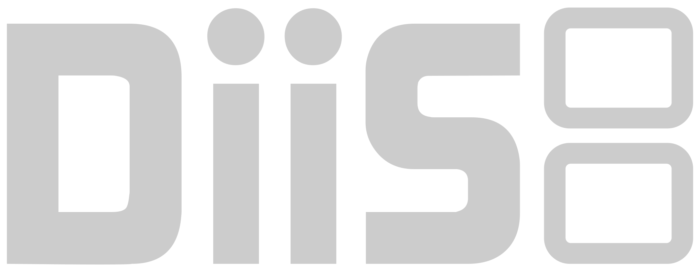

<p align="center">
  
</p>

# DiiS
DiiS is a homebrew DS emulator based on the original port of [DeSmuMEWii](https://github.com/bd452/desmumewii) but with significant preformance gains. Preformance still is not 100% but has improved significatly to the point I think a pre-release is justified ([See breakdown](BENCHMARKS.md)). Also compatable with GBA games. 

## Requirements
 
- A Wii with the Homebrew Channel installed, or Dolphin
  with a Wii SD card configured
- An SD card (or attached USB storage)
- Your own legally-dumped DS ROM(s)
- Your own DS BIOS and firmware dumps (optional, improved compatability) 
- GBA BIOS dumps (optional, improved compatability) 

## Features
- Nintendo DS emulation with ARM7 and ARM9 JIT recompilers
- Hardware-accelerated 3D rendering on the Wii GPU
- GBA slot-2 passthrough with its own JIT (for GBA-linked DS titles)
- Save states, battery saves, and cheat code support
- Wiimote, Nunchuk, Classic Controller, and GameCube controller input
- [Advance Input Expansion Pak](#advance-input-expansion-pak)

## Planned Features
- Per-Game settings
- Better UI
- Enhanced 3D resolution options
- Better overall preformance
- Prebuilt Channel WAD
- Setup wizard for virtual console style channels 

## Installation
 
1. Copy the built `.dol` (or `.elf`) onto your SD card, e.g.
   `sd:/apps/diis/boot.dol`, so the Homebrew Channel can find it. If you're
   running under Dolphin instead of real hardware, point Dolphin at the
   `.dol`/`.elf` directly (see `run.sh` for a scripted example using the
   Dolphin flatpak).
2. Put your ROMs (`.nds` and `.gba`) in a folder on the SD card or USB
   storage. DiiS looks in `sd:/ROMS/DS/` and `sd:/DS/ROMS/` out of the box;
   any other folder can be added in **Settings > ROM folders**.
3. If you have real DS BIOS dumps, name them exactly `biosnds7.rom` and
   `biosnds9.rom` and place them in `DS/BIOS/` on the device DiiS starts from
   (`sd:/DS/BIOS/` normally). Without them, DiiS falls back to internal HLE
   BIOS/firmware, which works for most games but not all.
4. DiiS keeps its own files in `DiiS/` on the device it starts from:
```
   DiiS/config.ini                 - settings and the ROM folder list
   DiiS/library.cache              - so the library doesn't re-read every ROM on each start
   DiiS/games/<id> <title>/        - one folder per game: battery save, save states,
                                     per-game settings
```
   Saves from older versions in `sd:/DS/SAVES/` are moved into the game's
   folder the first time you play it.

## Usage
 
### Starting a game
 
DiiS opens on the **Library**: an icon grid of every game in your ROM
folders, filtered by All / DS / GBA. Pick a game to see its details, then
**Play**, or **Load state** to jump straight into one of its save states.

- **Settings** (top right) sets the defaults for every game: CPU emulation
  (**JIT**, the default and fastest, or **Interpreter**, slower, for
  troubleshooting a game the JIT gets wrong) and render mode (**GxFast**,
  **GxAccurate** or **Software**). It also manages the ROM folders (Add folder,
  Remove, include subfolders, Rescan) and has the About screen.
- **Game settings** on a game's page overrides the CPU and render mode for
  just that game; "Default" follows Settings.

| Action | Control |
|---|---|
| Move selection | D-pad / stick, or point with the Wiimote |
| Select | A |
| Back | B |
| Quit to loader | HOME, or console Reset / Power |

### In-game controls
 
Default mapping (Classic Controller shown; GameCube controller mirrors A/B/X/Y,
L/R, Start, and Select):
 
| DS button | Wiimote (Classic Controller) | GameCube controller |
|---|---|---|
| A / B / X / Y | A / B / X / Y | A / B / X / Y |
| D-Pad | D-Pad | Control stick / D-pad |
| L / R | Full L / Full R | L / R trigger |
| Start / Select | Plus / Minus | Start / D-pad Right |
 
Touch screen input is handled with the Wiimote IR pointer (or the GameCube
controller's equivalent, where mapped).
 
### Hotkeys
 
| Function | Control |
|---|---|
| Quick-save state (slot 0) | Hold Z, tap L (GameCube controller) |
| Quick-load state (slot 0) | Hold Z, tap R (GameCube controller) |
| Toggle debug console | Wiimote button 1 / D-pad Left |
| Toggle screen layout | Wiimote button 2 / D-pad Up |
| Toggle cursor display | Wiimote B / D-pad Right |
| Adjust frame skip | Wiimote Plus / Minus |
| Quit to loader | HOME, or Z + L + R together (GameCube controller) |
 
### Notes
 
- There is currently no in-game settings menu - control remapping, BIOS
  paths, and similar options are set at compile time; CPU and render mode are
  set from the menu before a game starts.
- Save states and battery saves are written to the game's folder,
  `DiiS/games/<id> <title>/`.


## Advance Input Expansion Pak
This addition was mostly for the sake of my own homebrew plans. It is an entirely fictional Slot-2 (GBA slot) accessory which gives full modern controller input for the Nintendo DS. That includes:
- Controller type flags
- All default DS inputs
- Dual Analog Joysticks
- Joystick presses
- Analog Triggers
- Rumble (through in-built compatability with RumblePak)

## License/Credations
 
DiiS is free software, licensed under the GNU General Public License v2 - see `LICENSE.txt`. It builds on DeSmuME and DeSmuMEWii, and vendors a
JIT derived from Visual Boy Advance GX (see
`source/jit/upstream/PROVENANCE.md` for details and attribution).
